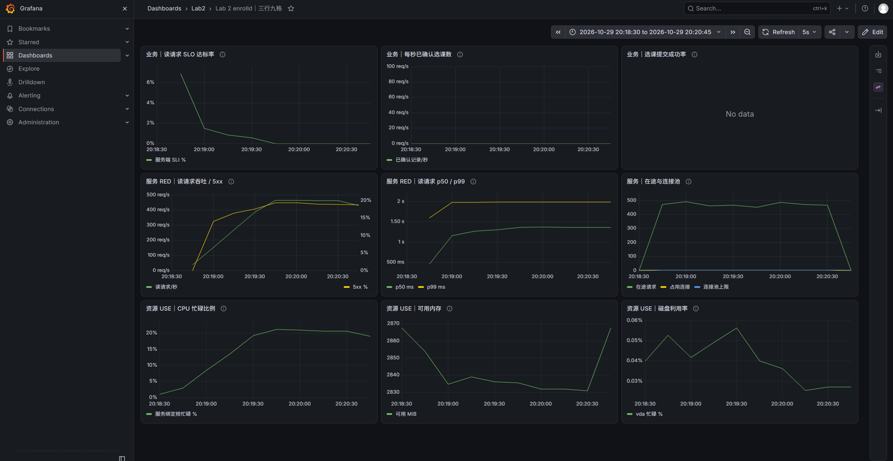

# 实验 2 记录：第 12 组

评分时依据本文件和 `runs/` 中的原始数据核对。本文件中的每一个数值，都须能在某个 `runs/<名字>/` 的文件中找到：表格用 `scripts/table.sh` 生成后粘贴，其他数值注明出处（例如“`runs/r1-pool4/red.csv` 第 6 阶段”）。不要只贴截图。将 `<填写>` 替换为本组的内容。

第 4.1、4.4、5.1、5.3 节的预测须在对应的测量之前写好，写好后不要修改。预测错误不扣分，与实测不一致之处在分析中讨论。

## 1. 基本信息

| 项 | 内容 |
|---|---|
| 小组 | 第 12 组 |
| 仓库地址 | https://github.com/KanaScale/ops-lab2-12 |
| 主机 | 华为云 Flexus X，华东-上海一，通用计算型 x1.2u.4g（2 vCPU、4 GiB） |
| CPU | `General Purpose Processor`；2 个 vCPU；`lscpu -e` 显示 CPU 0 → CORE 0、CPU 1 → CORE 0 |
| 内存 | `free -m` 的 Mem total：3531 MiB |
| 数据目录所在的盘 | `findmnt -T data`：SOURCE `/dev/vda1`，FSTYPE `ext4`；`lsblk`：`vda` 40G，`vda1` 挂载于 `/`；ECS 控制台显示系统盘为通用型 SSD 云盘、40 GiB |
| 操作系统与内核 | `Ubuntu 24.04.4 LTS`；`6.8.0-136-generic` |
| Go、Prometheus、node_exporter | `go version go1.26.9 linux/amd64`；`prometheus, version 3.13.4`；`node_exporter, version 1.12.1` |
| 分核 | enrolld：逻辑 CPU 1；loadgen、Prometheus、node_exporter：逻辑 CPU 0。 |

## 2. 任务 0：基线

`bin/enrolld -bench-fsync 2000` 连续运行三次的输出：

```text
fsync 次数 2000，总耗时 2.56 s，数据目录 data
fsync 耗时（毫秒）：mean 1.276  p50 1.166  p90 1.610  p99 2.644  max 12.290
按平均值推算，一个写者串行 fsync 每秒最多约 784 次（= 1000 / 1.276）
fsync 次数 2000，总耗时 2.52 s，数据目录 data
fsync 耗时（毫秒）：mean 1.253  p50 1.166  p90 1.532  p99 2.463  max 4.448
按平均值推算，一个写者串行 fsync 每秒最多约 798 次（= 1000 / 1.253）
fsync 次数 2000，总耗时 2.54 s，数据目录 data
fsync 耗时（毫秒）：mean 1.262  p50 1.167  p90 1.600  p99 2.507  max 4.847
按平均值推算，一个写者串行 fsync 每秒最多约 792 次（= 1000 / 1.262）
```

三次 `mean` 的平均值为 (1.276 + 1.253 + 1.262) / 3 ≈ 1.264 ms，
按平均值计算，单个写者串行 fsync 每秒最多约 791 次（1000 / 1.264）。
三次 `mean` 的最大差值为 0.023 ms，约为三次平均值的 1.8%；

**空载和运行 fsync 测试时各工具的读数**（各观察 5 秒以上，填写典型值）：

以下空载值跳过了工具启动后的第一组开机平均值；运行值只取 `bin/enrolld -bench-fsync 5000` 尚在执行时的稳定读数，不包含结束后回落的行。该次 5000 次测试输出的 `mean` 为 1.268 ms，总耗时 6.37 s；它只用于观察负载，不参与上面的三次平均值计算。

| 工具与列 | 空载 | 运行 `-bench-fsync` 时 | 该列的含义 |
|---|---|---|---|
| `vmstat -w 1`：r、b | r=0、b=0 | r=0、b=1 | r：可运行或等待 CPU 的进程数；b：因 I/O 等待而阻塞的进程数 |
| `vmstat -w 1`：us、sy、id、wa、st | us=0～1%、sy=0～1%、id=99～100%、wa=0%、st=0% | us=0～1%、sy=3～4%、id=49～53%、wa=45～47%、st=0% | CPU 时间占比：用户态、内核态、空闲、等待 I/O、被宿主机占用 |
| `iostat -dx 1 vda`：w/s、wkB/s | 通常 w/s=0～2、wkB/s=0～8；偶见 8、52 | 稳定阶段 w/s=2308～2387、wkB/s=12580～13064 | 每秒写请求数、每秒写入量 |
| `iostat -dx 1 vda`：w_await、f/s、f_await | 有写入时 w_await=0.50～1.00 ms；f/s 通常为 0、偶见 2；f_await=0 ms | w_await=0.40～0.42 ms、f/s=1539～1590、f_await=0.04 ms | 写请求平均等待时间（ms）、每秒 flush 次数、flush 平均等待时间（ms） |
| `iostat -dx 1 vda`：aqu-sz、%util | 通常 aqu-sz=0、%util=0%；偶见 0.10、0.10% | aqu-sz=1.02～1.03、%util=95.20～97.20% | 平均在途 I/O 数、设备至少有一个 I/O 请求在处理的时间占比 |

运行 fsync 测试时，CPU 的计算部分并不繁忙：`us + sy` 约 3～5%，但 `wa` 达 45～47%，另有约 49～53% 的 `id`。
等待主要体现在 `vmstat` 的 `b=1`、`wa` 升高；`iostat` 中 `aqu-sz` 约 1.02～1.03、`%util` 约 95～97%，也表明磁盘 I/O 持续活跃。

## 3. 任务 1：指标流水线

两个抓取目标的状态（`curl -s 127.0.0.1:9090/api/v1/targets` 中两处 `"health"` 的值）：`up`、`up`。

本组编写的四条查询（与 `deploy/queries-red.txt` 一致）：

```text
server_rps          sum(rate(http_requests_total{route="${route}"}[${window}]))
server_error_rate   (sum(rate(http_requests_total{route="${route}",code=~"5.."}[${window}])) or vector(0)) / sum(rate(http_requests_total{route="${route}"}[${window}]))
server_p99_ms       1000 * histogram_quantile(0.99, sum by (le) (rate(http_request_duration_seconds_bucket{route="${route}"}[${window}])))
server_slo_good     sum(rate(http_request_duration_seconds_bucket{route="${route}",code="200",le="${slo}"}[${window}])) / sum(rate(http_request_duration_seconds_count{route="${route}"}[${window}]))
```

`runs/t1-light` 的数据（`scripts/table.sh runs/t1-light ok_rps mean_ms p99_ms server_rps server_mean_ms server_p99_ms cpu_ms_per_req db_query_mean_ms`）：

| step | target_rps | ok_rps | mean_ms | p99_ms | server_rps | server_mean_ms | server_p99_ms | cpu_ms_per_req | db_query_mean_ms |
|---|---|---|---|---|---|---|---|---|---|
| 1 | 0 | 0.0 | - | - | - | - | - | - | NaN |
| 2 | 50 | 50.5 | 11.37 | 12.51 | 51.75 | 10.6892 | 19.9 | 0.503509 | 10.2811 |
| 3 | 100 | 97.8 | 11.55 | 14.01 | 95.4167 | 10.8687 | 19.9043 | 0.501774 | 10.421 |
| all | - | 74.2 | 11.49 | 13.18 | - | - | - | - | - |

从这次实验读出：每次查询实际占用连接 10.421 ms（`runs/t1-light/red.csv` 第 3 阶段的 `db_query_mean_ms`）；每个请求消耗的 CPU 0.501774 ms（同一阶段的 `cpu_ms_per_req`，取 100 请求/秒的阶段）。

## 4. 任务 2：读路径

### 4.1 预测（R1 之前写）

| 资源 | 容量 | 每个请求占用（数据来源） | 推算的上限（请求/秒） |
|---|---|---|---|
| 连接池 | 默认 `-pool 4`，4 个连接 | 10.421 ms（`runs/t1-light/red.csv` 第 3 阶段的 `db_query_mean_ms`） | `4 × 1000 ÷ 10.421 ≈ 384` |
| CPU | enrolld 绑定的 1 个逻辑 CPU | 0.501774 ms（`runs/t1-light/red.csv` 第 3 阶段的 `cpu_ms_per_req`） | `1 × 1000 ÷ 0.501774 ≈ 1993` |

先达到上限的是：**连接池**（预测约 384 请求/秒，远小于 CPU 的约 1993 请求/秒）。
预计从约 346 请求/秒（预测上限的 0.9 倍）起，客户端 p99 超过 50 ms；
理由：到达率接近连接池处理能力时，少量请求需要等待连接，尾部延迟会在吞吐量达到理论上限前明显上升。如果取上限的 1.0 倍（即 384 * 1.0 = 384）大概率早已超过 50 ms 了，所以退一步选择上限的 0.9 倍。

R1 的到达率（`scripts/rates.sh 384` 的输出）：`77,154,230,269,307,346,384,422,461` 请求/秒。

### 4.2 R1：`-pool 4`

`scripts/table.sh runs/r1-pool4 ok_rps error_rate p99_ms server_p99_ms server_mean_ms inflight_avg cpu_ms_per_req pool_in_use_avg pool_wait_p99_ms sched_wait_p99_ms svc_cpu_busy procs_running_avg`：

| step | target_rps | ok_rps | error_rate | p99_ms | server_p99_ms | server_mean_ms | inflight_avg | cpu_ms_per_req | pool_in_use_avg | pool_wait_p99_ms | sched_wait_p99_ms | svc_cpu_busy | procs_running_avg |
|---|---|---|---|---|---|---|---|---|---|---|---|---|---|
| 1 | 77 | 79.0 | 0.0000 | 12.95 | 19.9 | 10.7916 | 0.6 | 0.496973 | 0.6 | 1.38143 | 0.486989 | 0.0455 | 2 |
| 2 | 154 | 152.8 | 0.0000 | 18.08 | 19.9295 | 11.1839 | 1.92 | 0.510682 | 1.88 | 7.93286 | 0.496757 | 0.0805 | 2.6 |
| 3 | 230 | 229.8 | 0.0000 | 22.51 | 35.0514 | 12.0006 | 3.04 | 0.490693 | 2.76 | 13.8646 | 0.527283 | 0.112 | 2 |
| 4 | 269 | 273.9 | 0.0000 | 31.63 | 46.9368 | 13.7557 | 4.44 | 0.47427 | 3.08 | 23.0932 | 0.489276 | 0.127 | 1.4 |
| 5 | 307 | 311.1 | 0.0000 | 46.12 | 49.2497 | 16.2292 | 4.48 | 0.473579 | 3.12 | 44.7566 | 0.490593 | 0.1415 | 1.6 |
| 6 | 346 | 342.4 | 0.0000 | 59.64 | 86.3614 | 21.6785 | 7.28 | 0.470191 | 3.72 | 49.9044 | 0.492728 | 0.156 | 3 |
| 7 | 384 | 385.3 | 0.0034 | 1005.78 | 994.114 | 506.695 | 199.32 | 0.467567 | 4 | 989.974 | 0.491912 | 0.171 | 1.6 |
| 8 | 422 | 374.1 | 0.1040 | 1011.74 | 1982.17 | 997.416 | 415.4 | 0.445884 | 4 | 1901.78 | 0.491179 | 0.1875 | 1.6 |
| 9 | 461 | 375.1 | 0.1897 | 1011.94 | 1987.42 | 1002.64 | 464.4 | 0.449122 | 4 | 1949.07 | 0.494882 | 0.204 | 2.2 |
| all | - | 280.4 | 0.0499 | 1011.19 | - | - | - | - | - | - | - | - | - |

最大成功吞吐量 385.3 请求/秒，出现在第 7 阶段。
客户端 p99 首次超过 50 ms 是第 6 阶段（目标 346、实际成功 342.4 请求/秒）
和 4.1 节的预测接近，但由于此时超出 50 ms 较多，精确的阈值应该在 307 - 346 之间

>PS：从表中可以看出当 RPS 达到预测上限的 1.0、1.1、1.2 倍时，pool_in_use_avg 达到 4，说明连接已经供不应求了，但 svc_cpu_busy 最多只有 0.204，说明 CPU 利用率还很低。这说明 R1 场景下，随着加压，连接池先达到上限。

### 4.3 CPU 消耗在何处

在约 0.8 倍预测上限（307 请求/秒）的负载下采集 20 秒 CPU 剖析，`go tool pprof -top` 的前 10 行（同时保存在 `runs/r1-pool4/pprof-top.txt`）：

```text
      flat  flat%   sum%        cum   cum%
     2.18s 87.90% 87.90%      2.18s 87.90%  main.spin (inline)
     0.16s  6.45% 94.35%      0.16s  6.45%  internal/runtime/syscall/linux.Syscall6
     0.01s   0.4% 94.76%      0.06s  2.42%  bufio.(*Reader).fill
     0.01s   0.4% 95.16%      0.04s  1.61%  runtime.netpoll
     0.01s   0.4% 95.56%      0.14s  5.65%  syscall.RawSyscall6
         0     0% 95.56%      0.06s  2.42%  bufio.(*Reader).Peek
         0     0% 95.56%      0.12s  4.84%  bufio.(*Writer).Flush
         0     0% 95.56%      0.05s  2.02%  internal/poll.(*FD).Read
         0     0% 95.56%      0.10s  4.03%  internal/poll.(*FD).Write
         0     0% 95.56%      0.15s  6.05%  internal/poll.ignoringEINTRIO (inline)
```

`main.spin` 占 87.90% 的 CPU 样本。按本次的吞吐量和 enrolld 消耗的 CPU 计算，enrolld 每秒使用 0.147974 核、服务端每秒处理 312.458 个请求，故每请求 CPU 为 `1000 × 0.147974 ÷ 312.458 ≈ 0.474` ms。其中 spin 约 `0.473579 × 87.90% ≈ 0.416` ms，其余约 `0.057` ms，消耗主要用于 HTTP 读写、系统调用和 Go 运行时。

### 4.4 R2：调大连接池（预测在 R2 之前写）

| 项 | 值与算法 |
|---|---|
| 每个请求占用的 CPU（取 R1 哪一阶段的 `cpu_ms_per_req`，选取理由） | 取第 6 阶段的 0.470191 ms（`runs/r1-pool4/red.csv`）：这是连接池尚未持续满载、没有错误的最高负载阶段；第 7 阶段起池平均占用为 4 且出现约 1 秒的排队。 |
| 推算的 CPU 上限 C | `1 × 1000 ÷ 0.470191 ≈ 2127` 请求/秒；enrolld 只绑定 1 个逻辑 CPU。 |
| R2 的池大小 P2 = ceil(2 × C × 每次查询的秒数) | 同取第 6 阶段 `db_query_mean_ms=10.5594` ms，`ceil(2 × 2127 × 0.0105594) = 45`；对应池上限约 `45 ÷ 0.0105594 ≈ 4262` 请求/秒。 |
| R2 的到达率（`scripts/rates.sh C 0.3 0.6 0.8 0.9 1.0 1.1 1.25 1.5`） | `scripts/rates.sh 2127 0.3 0.6 0.8 0.9 1.0 1.1 1.25 1.5` → `638,1276,1702,1914,2127,2340,2659,3191` 请求/秒。 |
| 预测：R2 中先达到上限的是 | CPU：预测约 2127 请求/秒，低于新连接池约 4262 请求/秒的上限；需要用 R2 的 CPU 与排队指标检验。 |

`scripts/table.sh runs/r2-pool45 ok_rps error_rate p99_ms server_p99_ms inflight_avg cpu_cores cpu_ms_per_req cpu_wait_threads sched_wait_p99_ms pool_in_use_avg svc_cpu_busy procs_running_avg cpu_psi_some`：

| step | target_rps | ok_rps | error_rate | p99_ms | server_p99_ms | inflight_avg | cpu_cores | cpu_ms_per_req | cpu_wait_threads | sched_wait_p99_ms | pool_in_use_avg | svc_cpu_busy | procs_running_avg | cpu_psi_some |
|---|---|---|---|---|---|---|---|---|---|---|---|---|---|---|
| 1 | 638 | 642.0 | 0.0000 | 13.03 | 19.9 | 6.28 | 0.291266 | 0.453773 | 0.235205 | 0.577759 | 6.28 | 0.286 | 1.6 | 0.20524 |
| 2 | 1276 | 1282.2 | 0.0000 | 13.70 | 19.9 | 15.4 | 0.553641 | 0.432799 | 0.296819 | 1.46416 | 15.4 | 0.555 | 2.6 | 0.265566 |
| 3 | 1702 | 1696.4 | 0.0000 | 14.99 | 19.9 | 17.92 | 0.711856 | 0.418401 | 0.134518 | 2.38076 | 17.92 | 0.7085 | 2.2 | 0.131956 |
| 4 | 1914 | 1907.0 | 0.0000 | 16.51 | 19.9 | 19.76 | 0.79127 | 0.413637 | 0.0696892 | 3.98615 | 19.76 | 0.791 | 3.2 | 0.0751283 |
| 5 | 2127 | 2119.8 | 0.0000 | 20.10 | 19.9 | 21.96 | 0.872912 | 0.411751 | 0.0325694 | 5.46015 | 21.96 | 0.877 | 2 | 0.0423373 |
| 6 | 2340 | 2340.0 | 0.0000 | 32.70 | 19.9041 | 24.28 | 0.959348 | 0.409424 | 0.00990933 | 15.2675 | 24.28 | 0.957 | 2.4 | 0.0204269 |
| 7 | 2659 | 664.1 | 0.7499 | 1979.69 | 1972.65 | 1917 | 0.995688 | 0.409418 | 0.00809279 | 1000 | 38.4 | 1 | 2.6 | 0.0219542 |
| all | - | 1521.6 | 0.1575 | 1610.32 | - | - | - | - | - | - | - | - | - | - |

最大吞吐量 2340.0 请求/秒（出现在第 6 阶段）。比预测的 C=2127 高 213 请求/秒，约高 10.0%。
解释：第 6 阶段的每请求 CPU 已降至 0.409424 ms（表中 `cpu_ms_per_req` 字段）；据此重算的 CPU 上限约 `1000 ÷ 0.409424 ≈ 2442` 请求/秒，说明预测偏保守。

>PS：同 R2 的分析，当 RPS 来到 2127 * 1.25 = 2659 时，svc_cpu_busy = 1，CPU 已经跑满了，但是 pool_in_use_avg 只有 38.4 < 45，还有余量。说明 R2 场景下，随着加压，CPU 先达到上限。此时大量请求排队，队列长度单调增长，直到请求超时，p99 暴涨到 2s。

## 5. 任务 3：写路径

### 5.1 预测：`-sync each`（W1 之前写）

| 项 | 值与算法 |
|---|---|
| fsync 平均耗时（任务 0） | (1.276 + 1.253 + 1.262) / 3 ≈ 1.264 ms  |
| 推算的最大 TPS | 1000 / 1.264 ≈ 791 TPS |
| 达到上限时 enrolld 大约使用几个核（写路径没有 spin，按 4.3 节拆分出的“spin 以外的开销”估计每个写请求的 CPU） | 按第 4.3 节，每请求非 spin CPU 开销约为 0.473579 × (1 − 87.90%) ≈ 0.0573 ms；达到预测上限 791 TPS 时，CPU 使用量约为 791 × 0.0573 / 1000 ≈ 0.045 核，即单核的约 4.5%。 |
| W1 的到达率（`scripts/rates.sh <最大 TPS> 0.2 0.4 0.6 0.8 0.9 1.0 1.1 1.2`） | 以 791 TPS 为基准：158,316,475,633,712,791,870,949 请求/秒。 |

预测 W1 先受到串行 fsync 的限制，最大吞吐量约为 791 TPS，此时 CPU 仍有较大余量。

### 5.2 W1：`-sync each`

`scripts/table.sh runs/w1-<…> ok_rps error_rate p99_ms server_p99_ms cpu_cores fsync_per_s fsync_mean_ms batch_mean svc_cpu_busy cpu_iowait disk_w_per_s disk_w_await_ms disk_f_per_s disk_f_await_ms disk_aqu_sz disk_util`：

| step | target_rps | ok_rps | error_rate | p99_ms | server_p99_ms | cpu_cores | fsync_per_s | fsync_mean_ms | batch_mean | svc_cpu_busy | cpu_iowait | disk_w_per_s | disk_w_await_ms | disk_f_per_s | disk_f_await_ms | disk_aqu_sz | disk_util |
|---|---|---|---|---|---|---|---|---|---|---|---|---|---|---|---|---|---|
| 1 | 158 | 156.0 | 0.0000 | 5.55 | 4.96597 | 0.0179312 | 156.667 | 1.36187 | 1 | 0.0225 | 0.09425 | 465.05 | 0.436942 | 309 | 0.033657 | 0.21365 | 0.201 |
| 2 | 316 | 317.9 | 0.0000 | 6.44 | 7.30038 | 0.0313972 | 317.458 | 1.30626 | 1 | 0.034 | 0.184 | 946.4 | 0.422496 | 630.15 | 0.034833 | 0.42185 | 0.39915 |
| 3 | 475 | 483.9 | 0.0000 | 10.04 | 9.93651 | 0.0436081 | 485.542 | 1.26257 | 1 | 0.046 | 0.27025 | 1451.65 | 0.40919 | 966.75 | 0.0331523 | 0.62605 | 0.5911 |
| 4 | 633 | 630.7 | 0.0000 | 22.87 | 25.2803 | 0.0547006 | 628.292 | 1.28525 | 1 | 0.0565 | 0.35775 | 1894.4 | 0.41657 | 1262.6 | 0.0348883 | 0.83315 | 0.7872 |
| 5 | 712 | 709.8 | 0.0000 | 54.51 | 48.2521 | 0.0613922 | 707.208 | 1.28251 | 1 | 0.0645 | 0.394 | 2109.85 | 0.414579 | 1404.35 | 0.0355681 | 0.92465 | 0.868 |
| 6 | 791 | 789.1 | 0.0000 | 1003.05 | 1381.98 | 0.0716867 | 780.25 | 1.25066 | 1 | 0.074 | 0.425 | 2381.7 | 0.397342 | 1586.75 | 0.0351662 | 1.0022 | 0.93235 |
| 7 | 870 | 567.5 | 0.3446 | 1981.52 | 4890.24 | 0.0871027 | 806.917 | 1.22866 | 1 | 0.09 | 0.414 | 2429.9 | 0.395839 | 1616.75 | 0.0345755 | 1.01775 | 0.95275 |
| 8 | 949 | 0.0 | 1.0000 | - | 5000 | 0.122458 | 771.625 | 1.28841 | 1 | 0.115 | 0.3965 | 2316.3 | 0.41154 | 1542.4 | 0.0393543 | 1.01395 | 0.9426 |
| all | - | 456.9 | 0.2542 | 1960.74 | - | - | - | - | - | - | - | - | - | - | - | - | - |

W1 在第 6 阶段（目标 791 请求/秒）获得本次最高客户端成功吞吐量 789.1 TPS，比预测的 791 TPS 低约 0.24%。
第 6 阶段 enrolld 使用 `cpu_cores` = 0.0716867 核，高于预测的约 0.045 核，但仍远未耗尽一个核；而磁盘利用率为 `disk_util` = 93.235%，平均 I/O 队列长度为 `disk_aqu_sz` = 1.0022，请求逐渐积压。**可见串行 fsync 路径先达到上限**。

数据来源：runs/w1-each/steps.csv、red.csv、use.csv 和 loadgen.log

### 5.3 预测：`-sync group`（W2 之前写）

在 W1 达到上限时的到达率下，改为组提交后：吞吐量 790 TPS；平均每次 fsync 处理 1.5 条记录；客户端 p99 约  10 ms。理由：W1 达到上限时单次 fsync 平均耗时约 1.25 ms，这段时间内平均约有 1 条新请求到达。group 可以合并排队记录，减少每条记录分摊的 fsync 成本，预计能明显降低排队延迟。

W2 以 W1 实测上限的近似值 790 TPS 为基准，按 0.4、0.8、1.0、1.5、2、3、4 倍生成到达率，并加入 791 请求/秒作为与 W1 第 6 阶段的直接对照。

W2 的到达率：316,632,790,791,1185,1580,2370,3160 请求/秒。

### 5.4 W2：`-sync group`

（列与 5.2 相同）

| step | target_rps | ok_rps | error_rate | p99_ms | server_p99_ms | cpu_cores | fsync_per_s | fsync_mean_ms | batch_mean | svc_cpu_busy | cpu_iowait | disk_w_per_s | disk_w_await_ms | disk_f_per_s | disk_f_await_ms | disk_aqu_sz | disk_util |
|---|---|---|---|---|---|---|---|---|---|---|---|---|---|---|---|---|---|
| 1 | 316 | 315.7 | 0.0000 | 4.32 | 4.8862 | 0.0299376 | 286.375 | 1.29017 | 1.09676 | 0.0385 | 0.16275 | 855.85 | 0.41637 | 569.5 | 0.0317823 | 0.37445 | 0.35125 |
| 2 | 632 | 641.3 | 0.0000 | 4.59 | 4.93729 | 0.0505314 | 496.625 | 1.25678 | 1.29893 | 0.0555 | 0.2715 | 1486.6 | 0.406935 | 990.3 | 0.0327678 | 0.63735 | 0.6 |
| 3 | 790 | 789.2 | 0.0000 | 4.67 | 4.94578 | 0.0577074 | 562.5 | 1.25264 | 1.40222 | 0.065 | 0.30425 | 1688.85 | 0.404151 | 1123.85 | 0.0337234 | 0.72045 | 0.67665 |
| 4 | 791 | 789.6 | 0.0000 | 4.67 | 4.94756 | 0.0569693 | 564.833 | 1.23139 | 1.39355 | 0.0595 | 0.2995 | 1700.75 | 0.395326 | 1131.75 | 0.0310581 | 0.70745 | 0.6607 |
| 5 | 1185 | 1183.4 | 0.0000 | 4.69 | 4.96265 | 0.0727801 | 688.542 | 1.22731 | 1.71891 | 0.077 | 0.35825 | 2069.95 | 0.395372 | 1379 | 0.0329949 | 0.8639 | 0.81475 |
| 6 | 1580 | 1573.8 | 0.0000 | 4.86 | 4.9754 | 0.0879152 | 745.583 | 1.23139 | 2.11943 | 0.09 | 0.384 | 2249.5 | 0.394866 | 1498.5 | 0.0336336 | 0.9386 | 0.88445 |
| 7 | 2370 | 2361.5 | 0.0000 | 5.31 | 4.98546 | 0.106844 | 753.167 | 1.29289 | 3.13443 | 0.107 | 0.4035 | 2309.45 | 0.408972 | 1536.4 | 0.0341382 | 0.99695 | 0.9365 |
| 8 | 3160 | 3160.3 | 0.0000 | 5.52 | 4.98521 | 0.124067 | 764.583 | 1.28927 | 4.13935 | 0.123 | 0.39975 | 2310.35 | 0.412383 | 1537.5 | 0.0358374 | 1.00785 | 0.94715 |
| all | - | 1351.8 | 0.0000 | 5.15 | - | - | - | - | - | - | - | - | - | - | - | - | - |

在相同目标到达率 791 请求/秒下，W1 第 6 阶段与 W2 第 4 阶段的成功吞吐量分别为 789.1 和 789.6 TPS，基本一致；客户端 p99从 1003.05 ms 降至 4.67 ms，降低约 99.53%。
两者吞吐接近是因为到达率相同，组提交在此负载下的主要收益是消除严重排队。

该阶段 W2 的 `batch_mean` 为 1.39355，`fsync_per_s` 为 564.833，相比 W1 的每笔一次 fsync，减少了每条记录分摊的落盘次数。
- 预测吞吐约 790 TPS，与实测 789.6 TPS 接近；
- 预测批量约 1.5 条，实测低约 7.1%；
- 预测 p99 约 10 ms，实测为 4.67 ms，低于预测。

组提交降低排队延迟的方向判断正确。

随着目标到达率从 316 增至 3160 请求/秒，`batch_mean` 从 1.09676 增至 4.13935。
- 低负载时平均批量接近 1，合并收益较小；
- 负载增大后，更多排队记录可合并到一次 fsync 中，吞吐随之提升。

W2 第 8 阶段成功吞吐量为 3160.3 TPS，无错误，p99 为 5.52 ms。此时磁盘利用率为 94.715%，与 W1 第 6 阶段的 93.235% 接近，但成功吞吐量约为后者的 4.00 倍。
这说明设备忙碌比例相近时，应用吞吐仍可通过批量提交显著提升。

本次 W2 测到的最高成功吞吐量为 3160.3 TPS，尚未观察到其吞吐上限。

数据来源：runs/w1-each/steps.csv、red.csv、use.csv，
以及 runs/w2-group/steps.csv、red.csv、use.csv。

### 5.5 W3：`-sync interval`

（列与 5.2 相同）

| step | target_rps | ok_rps | error_rate | p99_ms | server_p99_ms | cpu_cores | fsync_per_s | fsync_mean_ms | batch_mean | svc_cpu_busy | cpu_iowait | disk_w_per_s | disk_w_await_ms | disk_f_per_s | disk_f_await_ms | disk_aqu_sz | disk_util |
|---|---|---|---|---|---|---|---|---|---|---|---|---|---|---|---|---|---|
| 1 | 316 | 315.7 | 0.0000 | 1.16 | 0.99 | 0.01624 | 1 | 1.98051 | 314.083 | 0.0255 | 0.00125 | 5.9 | 0.627119 | 2 | 0.05 | 0.00375 | 0.0021 |
| 2 | 1185 | 1190.6 | 0.0000 | 1.18 | 0.99 | 0.0551906 | 1 | 2.36441 | 1191.71 | 0.068 | 0.001 | 4.95 | 0.656566 | 2 | 0.05 | 0.00335 | 0.00245 |
| 3 | 3160 | 3156.6 | 0.0000 | 1.26 | 0.99 | 0.093725 | 1 | 3.11171 | 3151.92 | 0.0995 | 0.00125 | 4.95 | 0.818182 | 2 | 0.025 | 0.00415 | 0.00305 |
| all | - | 1554.3 | 0.0000 | 1.23 | - | - | - | - | - | - | - | - | - | - | - | - | - |

在目标 3160 RPS 下，W3 成功吞吐量为 3156.6 TPS，与 W2 的 3160.3 TPS 接近；但客户端 p99 从 5.52 ms 降至 1.26 ms，降低约 77.2%。
由于两次实验的到达率相同，此处体现的主要收益是延迟和资源开销降低，而非成功吞吐量增加。

该阶段 `fsync_per_s` 从 W2 的 764.583 降至 W3 的 1，`batch_mean` 从 4.13935 增至 3151.92；磁盘利用率从 94.715% 降至 0.305%，`enrolld` 的 CPU 使用量从 0.124067 核降至 0.093725 核。

分析：interval 模式先将记录写入页缓存并返回，再每秒执行一次 fsync，因此请求不必等待落盘。代价是**机器掉电时可能丢失最近约一个同步周期内已经返回成功的记录**。
- 对于要求确认成功后持久保存的选课记录，group 更合适；
- 仅在业务允许该丢失窗口，或具备可靠重放与补偿机制时，才考虑 interval。

数据来源：runs/w2-group/steps.csv、red.csv、use.csv，
以及 runs/w3-interval/steps.csv、red.csv、use.csv。

## 6. 分析问题

每题先列出所用数据（引用上面的表或 `runs/` 中的文件），再写结论，并说明结论的成立条件。每题 300～600 字。

### 问题 1：上限由什么决定。
按 L-07 第 25 页资源账的格式，为 enrolld 的读路径编制一份资源账：资源、每个请求占用（实测）、容量、推算的上限、实测的最大吞吐量、饱和观测项。预测与实测相差多少，差异来自何处？`cpu_ms_per_req` 随负载如何变化，原因是什么？这对“在低负载下测量每请求开销，再推算上限”的做法意味着什么？`db_query_mean_ms` 为什么大于 `-db-ms`？以“p99 ≤ 50 ms”为目标，R1 能承受的最大阶段相当于上限的多少比例？与 L-07 第 6 页“容量 = 上限 × 0.7”比较，为什么尚未达到上限延迟就已上升？R2 调大连接池后，瓶颈转移到了哪个资源？

数据：第 3、4 节表及 `runs/t1-light/red.csv`、`runs/r1-pool4/{steps,red,use}.csv`、`runs/r2-pool45/{steps,red,use}.csv`。以下资源账中的推算使用测前数据，吞吐量取客户端成功速率。

#### 1.1 资源账
| 资源 | 每请求占用（实测） | 容量 | 推算上限（请求/秒） | 实测最大吞吐量（请求/秒） | 饱和观测项 |
|---|---|---|---|---|---|
| R1 连接池 | t1 第 3 阶段查询占用 10.421 ms | 4 个连接 | 4 / 0.010421 ≈ 384 | R1 第 7 阶段 385.3，已有错误及积压 | 第 7～9 阶段池占用为 4，等连接 p99 为 989.974～1949.07 ms |
| R1 CPU | t1 第 3 阶段 0.501774 ms | 1 核 | 1000 / 0.501774 ≈ 1993 | 整条路径最高 385.3，CPU 上限未测到 | 第 7 阶段 CPU 忙碌 17.1%，未耗尽 |
| R2 CPU | R1 第 6 阶段 0.470191 ms | 1 核 | 1000 / 0.470191 ≈ 2127 | 第 6 阶段稳定成功 2340.0；第 7 阶段降至 664.1 | 第 7 阶段 CPU 忙碌 100%，Go 调度等待 p99 为 1000 ms |
| R2 连接池 | R1 第 6 阶段查询占用 10.5594 ms | 45 个连接 | 45 / 0.0105594 ≈ 4262 | 整条路径稳定成功 2340.0，池上限未单独测到 | CPU 过载阶段池平均占用 38.4，未持续占满 |

#### 1.2 预测与实测相差多少，差异来自何处？
- R1 的连接池上限预测为 384 RPS，第 7 阶段成功速率为 385.3 RPS，高约 0.34%。但该阶段已经严重排队，不满足延迟要求。
- R2 的 CPU 上限预测为 2127 RPS，稳定成功速率达到 2340 RPS，高约 10.0%。原因可能是：
    - **CPU 平均开销**：预测 R2 的 CPU 上限时用的是 R1 中的 `cpu_ms_per_req` 数据，但是 R2 负载高于 R1，高负载下某些固定 CPU 开销会被更多请求摊薄，平均开销下降，由公式 CPU 上限（RPS）≈ 可用 CPU 核数 × 1000 ÷ `cpu_ms_per_req` ，实际上限会更高
    - **缓存**：高负载下可能提高缓存命中率，减少部分重复计算或数据访问开销。
    - **调度效率、连接池配置**：不同负载下，批量处理、连接复用和调度行为可能发生变化。

#### 1.3 `cpu_ms_per_req` 随负载如何变化，原因是什么？
上小问也提到了，负载升高后，`cpu_ms_per_req` 会降低：测前轻负载为 0.501774 ms，R1 第 6 阶段为 0.470191 ms，R2 第 6 阶段为 0.409424 ms，呈下降趋势。其原因在 1.2 中分析过。

#### 1.4 这对“在低负载下测量每请求开销，再推算上限”的做法意味着什么？
容量预测依赖的单位请求资源开销会**随着负载变化而变化**。低负载下测得的 `cpu_ms_per_req` 可能**高估**高负载下的实际平均 CPU 开销，从而**低估**系统的真实吞吐能力。
从中得到的启示：
- 单位请求资源开销不是固定常数。`cpu_ms_per_req` 会受到负载、缓存、调度、连接复用等因素影响。因此，不能简单地认为轻负载下测得的单位请求 CPU 开销可以直接用于高负载容量预测。
- 容量预测需要考虑实际负载条件。最好在多个负载水平下测量，然后观察它们之间的关系，而不是只使用一个轻负载测量值。

#### 1.5 `db_query_mean_ms` 为什么大于 `-db-ms`？
`-db-ms 10` 指定模拟查询至少占用连接约 10 ms；实际测量还包含持有连接期间的实际睡眠及唤醒、调度时间，所以轻负载实测为 10.421 ms，不是精确的 10 ms。

#### 1.6 以“p99 ≤ 50 ms”为目标，R1 能承受的最大阶段相当于上限的多少比例？
最后一个达标阶段是目标 307 RPS，客户端 p99 46.12 ms；它是预测上限 384 的 `307÷384 ≈ 79.9%`。下一个目标 346 的 p99 已是 59.64 ms。因此按本次阶段粒度，只能说达标边界位于 307～346 请求/秒之间。粗略估计 R1 最多能到上限的 **85%**

#### 1.7 与 L-07 第 6 页“容量 = 上限 × 0.7”比较，为什么尚未达到上限延迟就已上升？
0.7 是预留容量的经验做法，不是延迟开始上升的固定阈值。
请求到达和单次处理时间会波动：即使平均到达率低于理论上限，由于随机到达和服务波动，也有可能在某些瞬间把 4 个连接全部占满，后来的请求开始等待，尾部延迟便先上升。

#### 1.8 R2 调大连接池后，瓶颈转移到了哪个资源？
转到了 enrolld 所绑的 CPU。第 7 阶段该核忙碌率达到 100%，而连接池平均只占用 38.4/45。

### 问题 2：利用率不等于饱和。
R1 达到上限时，enrolld 所在核的 CPU 利用率是多少？哪个数值最先表明资源已经饱和？R2 中 CPU 利用率接近 100% 时，内核层的 `procs_running_avg`、`cpu_psi_some`、`cpu_wait_threads` 和 Go 运行时层的 `sched_wait_p99_ms` 分别如何变化？为什么内核层几乎观察不到排队，排队发生在哪里？这与 L-06 第 16、17 页 Tomcat 的线程池有何相同之处？最后用 Little's Law 核对：从 R1 选取三个阶段，用 `server_rps × server_mean_ms` 计算在途请求数，并与 `inflight_avg` 比较；W 为什么必须用平均值而不能用 p99？哪个阶段不一致，原因是什么？

数据：第 4 节以及 `runs/r1-pool4/{red,use}.csv`、`runs/r2-pool45/{red,use}.csv`。

#### 2.1 R1 达到上限时，enrolld 所在核的 CPU 利用率是多少？
第 7 阶段连接池占满 4 个时，enrolld 所绑核的忙碌率仅 17.1%。这说明 **CPU 没满并不等于服务没有瓶颈**

#### 2.2 哪个数值先显示资源在排队？ 
- 第 6 阶段连接池平均占用已达 3.72/4，`pool_wait_p99_ms` 达 49.9044 ms；
- 第 7 阶段连接占用达到 4/4，等待 p99 跃至约 990 ms。

**等待时间和池占用**比 CPU 利用率更直接地显示了此处的瓶颈。

#### 2.3 R2 中 CPU 利用率接近 100% 时，内核层的 `procs_running_avg`、`cpu_psi_some`、`cpu_wait_threads` 和 Go 运行时层的 `sched_wait_p99_ms` 分别如何变化？

从第 6 到第 7 阶段：
| 指标 | 第 6 阶段 | 第 7 阶段 |
|---|---:|---:|
| CPU 忙碌率 | 95.7% | 100% |
| `procs_running_avg` | 2.4 | 2.6 |
| `cpu_psi_some` | 0.02043 | 0.02195 |
| `cpu_wait_threads` | 0.00991 | 0.00809 |
| `sched_wait_p99_ms` | 15.27 ms | 1000 ms |

#### 2.4 为什么内核层几乎观察不到排队，排队发生在哪里？
原因是服务设置了 `GOMAXPROCS=1`，同一时刻只有一个执行 Go 代码的线程占用该核。
大量等待执行的 goroutine 排在 Go 运行时的调度队列里，不会一一表现为内核中等待 CPU 的线程；全机内核指标还混有其他进程。
因此 Go 调度等待 p99 暴涨，而那几项内核指标没有同比例暴涨。

#### 2.5 这与 L-06 第 16、17 页 Tomcat 的线程池有何相同之处？
两者都有并发处理容量有限，超过容量的请求先排队这一现象；排队会先拉高延迟。
共同点包括：
- 系统的并发处理能力有限。
- 请求到达速度超过处理能力时，任务无法立即执行。
- 多余任务进入等待队列。
- 排队时间增加，导致请求延迟升高。
- 如果持续过载，还可能发生超时和错误。

#### 2.6 最后用 Little's Law 核对：从 R1 选取三个阶段，用 `server_rps × server_mean_ms` 计算在途请求数，并与 `inflight_avg` 比较
下表由 `scripts/table.sh runs/r1-pool4 server_rps server_mean_ms inflight_avg` 生成：
| step | target_rps | server_rps | server_mean_ms | inflight_avg |
|---|---|---|---|---|
| 1 | 77 | 80.5833 | 10.7916 | 0.6 |
| 2 | 154 | 154.042 | 11.1839 | 1.92 |
| 3 | 230 | 230.458 | 12.0006 | 3.04 |
| 4 | 269 | 276.542 | 13.7557 | 4.44 |
| 5 | 307 | 312.458 | 16.2292 | 4.48 |
| 6 | 346 | 344.375 | 21.6785 | 7.28 |
| 7 | 384 | 374.125 | 506.695 | 199.32 |
| 8 | 422 | 415.375 | 997.416 | 415.4 |
| 9 | 461 | 463.458 | 1002.64 | 464.4 |
| all | - | - | - | - |

用 Little 定律核对在途请求数。 用同一阶段的服务端完成速率乘以平均服务端耗时（毫秒先除以 1000）
选取第 1、6、9 阶段，计算得：
| R1 阶段 | `server_rps × server_mean_ms ÷ 1000` | `inflight_avg` |
|---|---:|---:|
| 第 1 阶段 | 0.87 | 0.60 |
| 第 6 阶段 | 7.47 | 7.28 |
| 第 9 阶段 | 464.68 | 464.40 |

#### 2.7 W 为什么必须用平均值而不能用 p99？
`L=λW` 对应的是一段时间内所有请求的平均停留时间。p99 只描述最慢的约 1% 请求的边界；用它乘吞吐量，算不出平均在途请求数。

#### 2.8 哪个阶段不一致，原因是什么？
第 6、9 阶段接近；第 1 阶段差异最大。原因可能是：
- 当平均在途数不足 1 时，每秒采一次瞬时在途数，采样相位就能造成很大的相对误差；
- 阶段切换和统计窗口不完全一致也会影响比较。


### 问题 3：持久性以延迟为代价。
W1 实测的最大 TPS 与 1000 ÷ fsync 平均耗时相比如何？W1 达到上限时 CPU、内存、磁盘的指标各是多少，哪几列表明磁盘饱和？应用测得的 `fsync_mean_ms` 与 `disk_w_await_ms`、`disk_f_await_ms` 为什么不同？一次 fsync 大约对应几次写和几次 flush？W1 与 W2 在 `disk_util` 相近时吞吐量相差多少，`%util` 接近 100% 能否说明磁盘已经饱和？组提交的 `batch_mean` 如何随负载变化，低负载时是否有收益，本组的预测是否正确？W3 快了多少，代价是什么？选课记录应采用哪一种方式，在什么条件下 interval 可以接受？

数据：第 2、5 节和 `runs/w1-each/{steps,red,use}.csv`、`runs/w2-group/{steps,red,use}.csv`、`runs/w3-interval/{steps,red,use}.csv`；模式语义见 `cmd/enrolld/commit.go`。

#### 3.1 W1 实测的最大 TPS 与 1000 ÷ fsync 平均耗时相比如何？
测前约 `1.264 ms/fsync`，估算上限 `1000 ÷ 1.264 ≈ 791 TPS`。
W1 第 6 阶段客户端成功速率为 `789.1` TPS，低约 `0.24%`，但当时已经明显积压；
如果用实测 `fsync_mean_ms = 1.25066` 反算约 `799.6 次/秒`，`789.1` 比它低约 `1.31%`。

#### 3.2 W1 达到上限时 CPU、内存、磁盘的指标各是多少，哪几列表明磁盘饱和？
取第 6 阶段：`enrolld` 使用约 `0.0717` 核，所绑核忙碌率 `7.4%`；最低可用内存约 `2829.73 MiB`、无换入；磁盘忙碌率约 `93.24%`、`disk_aqu_sz≈1.00`，整机 `iowait 42.5%`。
结合 fsync 速率接近平台、请求排队和延迟暴涨，说明瓶颈在串行写入并等待落盘的路径。
表明磁盘饱和的列包括：
- `disk_util`：约 93% - 95%，忙碌程度较高
- `fsync_per_s`：约 780 - 807，目标负载提升，每秒 fsync 数却没有同步增长（甚至反减），**最能说明磁盘饱和**。
- `disk_aqu_sz` 约 1.0，说明这条串行落盘路径持续有活干
- `cpu_iowait` 约 40% - 43%，说明CPU 有相当多时间在等待 I/O 完成

#### 3.3 应用测得的 `fsync_mean_ms` 与 `disk_w_await_ms`、`disk_f_await_ms` 为什么不同？
应用指标从调用 f.Sync() 到返回，覆盖文件系统、内核处理、等待及进程重新获得运行机会；磁盘 await 按设备层的单次写 I/O 或单次 flush I/O统计。一次应用 fsync 与设备 I/O 不是一一对应，测量边界也不同。

#### 3.4 一次 fsync 大约对应几次写和几次 flush？
W1 第 6 阶段用整盘速率粗算：
`2381.7 ÷ 780.25 ≈ 3.05` 次写
`1586.75 ÷ 780.25 ≈ 2.03` 次 flush。
注意这里只是粗略估计，整盘计数还含文件系统元数据及其他 I/O。

#### 3.5 W1 与 W2 在 `disk_util` 相近时吞吐量相差多少，`%util` 接近 100% 能否说明磁盘已经饱和？
W1 的 `disk_util` 约 93.24% 时成功 789.1 TPS；W2 的 `disk_util` 约 93.65% 时成功 2361.5 TPS，约 3 倍。
`%util` 接近 100% 只说明设备在观察期内几乎一直有 I/O；是否到达吞吐上限，还要一起看吞吐是否形成平台、队列与等待是否持续增长、应用延迟是否恶化。

#### 3.6 组提交的 `batch_mean` 如何随负载变化，低负载时是否有收益，本组的预测是否正确？
- W2 从目标 316 RPS 的约 1.10 条/批，增长到目标 3160 RPS 时的约 4.14 条/批
- 并发越高，等待中的记录越容易被一次 fsync 合并。低负载接近“一次同步一条”，合并收益有但不多。
- 同为目标约 791 RPS 时，实测 1.39 条/批接近预测的 1.5；实测客户端 p99 4.67 ms，好于预测的约 10 ms。预测的方向和批量量级是对的，延迟预测偏高。

#### 3.7 W3 快了多少，代价是什么？
同为目标 3160 请求/秒，W2 p99 5.52 ms，W3 p99 1.26 ms，约快 4.38 倍（降低约 77.2%）；两者成功吞吐都约 3160 TPS。
W3 的 interval 在写入页缓存后就返回成功，后台约每秒 fsync；
代价是**掉电时可能丢失已确认、尚未同步的记录，而且同步延迟或失败会扩大丢失窗口**。

#### 3.8 选课记录应采用哪一种方式，在什么条件下 interval 可以接受？
应该用 group：多条记录共用 fsync，但各请求要等这次 fsync 成功才返回，这样才能确保**显示“返回成功”时，记录一定已经持久化**。
只有业务明确允许丢失最近未同步的记录，或具备可靠重放、补偿机制时，才考虑 interval。


### 问题 4：延迟数值的测量位置与方法。
同一阶段中，客户端与服务端的平均值、p99 各相差多少？列出只计入客户端的时间组成。找出一个服务端 p99 大于客户端 p99 的阶段，并解释原因（L-08 第 10 页）。比较服务端的 `server_slo_good` 与客户端的 `slo_good`；若存在过载阶段，二者为何相差很大？SLI 应在何处测量（L-08 第 19 页）？用 R1 的 `steps.csv`，将各阶段的 p99 求平均，与 `all` 行的 p99 比较，说明百分位数为什么不能平均，以及正确的合并方法。最后计算错误预算：SLO 为“30 天内 99% 的读请求在 50 ms 内成功返回”，若 R1 中第一个不达标阶段的负载持续下去，燃烧率是多少，30 天的预算多久耗尽（L-08 第 21 页）？

数据：`runs/r1-pool4/{steps,red}.csv`、`runs/r2-pool45/{steps,red}.csv`；统计实现见 `cmd/loadgen/main.go`、`cmd/enrolld/main.go`、`cmd/promsteps/main.go`。


#### 4.1 同一阶段中，客户端与服务端的平均值、p99 各相差多少？
以 R1 第 1 阶段为例：
- 客户端平均 11.48 ms，服务端平均 10.7916 ms，客户端高 0.6884 ms；
- 客户端 p99 12.95 ms，服务端 p99 19.9 ms，客户端反而低 6.95 ms。

注意这些统计使用的样本、时间窗口和分位数算法不完全相同，差值不能直接解释为“网络耗时”。

#### 4.2 列出只计入客户端的时间组成。
客户端额外覆盖、服务端计时器没有完整覆盖的时间主要有：
-  **压测机发送滞后**：计划该发了，但 loadgen 的 goroutine 晚一点才开始执行。、
-  **客户端准备和发出请求**：构造请求、取得可复用连接；需要新连接时还包括建立连接。
-  **请求到达服务端处理函数之前的时间**：本实验走本机回环网络，仍有网络协议栈、服务端接收及进入处理函数前的等待。
-  **处理函数返回后，客户端读完响应的时间**：包括剩余的响应传递、读取响应体等。

等数据库连接池的时间不属于“只计入客户端”：请求已经进入服务端处理函数，服务端耗时也会记录这段等待。

#### 4.3 找出一个服务端 p99 大于客户端 p99 的阶段，并解释原因（L-08 第 10 页）。
以 R1 第 1 阶段为例：服务端 `p99 = 19.9 ms`，客户端 `p99 = 12.95 ms`。原因包括：
- **服务端 p99 是估计值**。 Prometheus 只有直方图的分桶计数，不知道桶内每个请求的准确耗时。它在 10～20 ms 的桶内插值，估出了接近上界的 19.9 ms。
- **客户端 p99 来自实际样本**。 loadgen 把成功请求的耗时排序，直接取排在 99% 位置的值，得到 12.95 ms。两种计算方法可能给出不同结果。
- **统计时间段不完全相同**。 客户端统计整个阶段发出的请求；服务端查询使用该阶段内的一个 Prometheus 采样窗口。两边不一定包含完全相同的一批请求。

>PS：一般还可能有成功与失败的样本差别，但本实验中不是这个原因。客户端延迟分位数只统计成功请求，服务端直方图包含各状态码，不过 R1 第 1 阶段没有失败请求。

#### 4.4 比较服务端的 `server_slo_good` 与客户端的 `slo_good`；若存在过载阶段，二者为何相差很大？
下表由 `scripts/table.sh runs/r1-pool4 mean_ms p99_ms server_mean_ms server_p99_ms slo_good server_slo_good` 生成：

| step | target_rps | mean_ms | p99_ms | server_mean_ms | server_p99_ms | slo_good | server_slo_good |
|---|---|---|---|---|---|---|---|
| 1 | 77 | 11.48 | 12.95 | 10.7916 | 19.9 | 1.0000 | 1 |
| 2 | 154 | 11.84 | 18.08 | 11.1839 | 19.9295 | 1.0000 | 1 |
| 3 | 230 | 12.60 | 22.51 | 12.0006 | 35.0514 | 1.0000 | 1 |
| 4 | 269 | 14.23 | 31.63 | 13.7557 | 46.9368 | 1.0000 | 1 |
| 5 | 307 | 16.46 | 46.12 | 16.2292 | 49.2497 | 0.9953 | 0.994933 |
| 6 | 346 | 21.58 | 59.64 | 21.6785 | 86.3614 | 0.9685 | 0.963339 |
| 7 | 384 | 466.64 | 1005.78 | 506.695 | 994.114 | 0.0528 | 0 |
| 8 | 422 | 998.02 | 1011.74 | 997.416 | 1982.17 | 0.0000 | 0 |
| 9 | 461 | 1003.41 | 1011.94 | 1002.64 | 1987.42 | 0.0000 | 0 |
| all | - | 377.09 | 1011.19 | - | - | 0.5260 | - |

- R1 第 6 阶段客户端 `slo_good = 0.9685`，服务端 `server_slo_good = 0.963339`，较接近。
- R2 第 7 阶段过载，分别为 `0.0472` 和 `0.306707`，差距较大

差异原因：
- **分母不同**。 客户端把该阶段实际发出的所有请求放进分母；服务端只统计其查询窗口内已完成并记录指标的请求。
- **计时起点不同**。 客户端从计划发送时刻算到读完响应；服务端从进入处理函数算到函数返回。过载时，发送滞后、建连、进入处理函数前的等待会让客户端超过 50 ms，即使服务端记录的处理耗时没有超过。
- **阶段归属和窗口不同**。 客户端按计划发送时刻把请求归入第 7 阶段；服务端使用该阶段末尾的 Prometheus 采样窗口。过载时请求大量跨越阶段边界，这两组请求尤其难以一一对应。

过载时差异更大的原理：
- **CPU 被打满**：enrolld 所绑核忙碌率达到 100%，Go 调度等待 p99 达 1000 ms。新请求仍不断到达，平均在途请求约 1917 个，形成积压。
- **客户端等不及了**：这一阶段发出 79,645 次请求，其中 47,335 次超时。客户端规定的是“成功且从计划发送起 50 ms 内收到完整响应”，所以排队太久或超时的请求都不达标，`slo_good` 只剩 4.72%。
- **服务端统计的是完成的请求**：`server_slo_good` 的分母是服务端统计窗口内完成的读请求。积压中的请求尚未完成，不会在此刻进入这个分母；有些后来可能以失败状态完成。服务端也没有计入客户端发晚、进入处理函数前的那段时间。因此其窗口内仍算出 30.67% 达标。

关键是过载使**已发出和已完成严重脱节**：客户端立即把大量等待、超时请求判为不达标，服务端同一窗口尚未把所有这些请求统计进去。正常负载下请求很快完成，两边统计的请求集合更接近，差距就小得多。

#### 4.5 SLI 应在何处测量（L-08 第 19 页）？
SLO 写的是“用户的读请求在 50 ms 内成功返回”，应**在用户或客户端边界测量**，并把失败计入分母。
关键是**测量位置要与 SLO 承诺的体验一致**。
不能在服务端测量，因为：
- 服务端计时**从请求进入处理函数才开始**。用户在此前可能已经等了
- 网络故障时，请求甚至可能根本没到服务端
- 过载时，还有大量请求正在排队或客户端已超时，服务端当前的“已完成请求”统计也未必包含它们。

#### 4.6 用 R1 的 `steps.csv`，将各阶段的 p99 求平均，与 `all` 行的 p99 比较，说明百分位数为什么不能平均，以及正确的合并方法。
R1 九个阶段的 p99 算术平均约 357.82 ms，而 all 行是 1011.19 ms。
p99 是合并后分布中排在 99% 位置的值，不满足“先各算再平均”；即使按阶段请求量加权平均也不行。
正确做法是**合并所有原始成功请求的延迟后重新求 p99**；若只有统一桶边界的直方图，则先合并桶再估计。

#### 4.7 最后计算错误预算：SLO 为“30 天内 99% 的读请求在 50 ms 内成功返回”，若 R1 中第一个不达标阶段的负载持续下去，燃烧率是多少，30 天的预算多久耗尽（L-08 第 21 页）？
由题，错误预算为 `1%`。
R1 中第 6 阶段目标 `346 RPS`，客户端达标率 `96.85%`，低于 `99%` SLO。
坏事件率是 `1 − 96.85% = 3.15%`；允许坏事件率是 `1%`，所以燃烧率为 `3.15`。
若请求量和坏事件比例持续不变、起初有完整预算，则大约 `30 ÷ 3.15 ≈ 9.52` 天耗尽。


以上派生计算可在仓库根目录运行 `python3 scripts/analyze-task4.py` 复核；脚本只读取已提交 CSV。直方图插值与分位数聚合方法参考 [Prometheus 官方文档](https://prometheus.io/docs/practices/histograms/)。

## 7. 选做记录

| 选做 | 完成情况与证据 |
|---|---|
| O1 内存与 GC | 已完成，测前预测、两组实测与结论见第 7.1 节；证据在 `runs/o1-gogc100/`、`runs/o1-gogc400/`。 |
| O2 网络 | 已完成，拓扑、测前预测、两端采样及结论见第 7.2 节；证据在 `runs/o2-net-server/` 和 `runs/o2-net-client/`。 |
| O3 告警与看板 | 已完成；规则、过载触发记录与九格查询见第 7.3 节。实测和看板截图在 `runs/o3-read-alert/`，定义在 `deploy/o3-dashboard.json`。 |
| O4 迁移到小组项目 | <未做 / 仓库链接、测了哪个资源、结论> |

### 7.1 O1：内存与 GC

#### 控制条件：
同一台云主机，`enrolld` 绑定 CPU 1，`loadgen` 绑定 CPU 0；两次均请求 `GET /api/report?mb=4`，目标到达率均为 100 请求/秒，持续 60 秒。每次重启服务，仅改变 `GOGC`（100 与 400）；实验前确认其他压测已停止。以客户端 `steps.csv` 的 `p99_ms`，以及 `deploy/queries-o1.txt` 在同一阶段稳定窗口查询的 GC 次数增量、GC CPU 时间增量和进程 RSS 平均/峰值比较。

#### 预测：
- `GOGC=400` 允许堆在触发下一轮 GC 前增长得更多，预计 GC 次数和 GC CPU 时间少于 `GOGC=100`，代价是进程 RSS 平均值或峰值更高；
- 客户端 p99 预计下降或变化很小。p99 还受调度和其他负载影响。
- 与 L-06 第 12 页的 JVM 堆与 GC 取舍相似：给回收器更多内存余量，通常能减少回收频度，但增加内存占用。

| GOGC | 目标请求/秒 | 成功请求/秒 | 客户端 p99 (ms) | GC 次数增量 | GC CPU 时间增量 (s) | RSS 平均 (MiB) | RSS 峰值 (MiB) | 堆对象平均 (MiB) |
|---|---:|---:|---:|---:|---:|---:|---:|---:|
| 100 | 100 | 99.8 | 2.85 | 5501.02 | 1.15768 | 12.2792 | 13.3438 | 1.21176 |
| 400 | 100 | 99.8 | 2.10 | 1375.00 | 0.349256 | 25.3784 | 25.4492 | 6.08697 |

两组各发出并成功完成 5989 个请求，错误率均为 0，压测机 CPU 均约 1%（两组 `loadgen.log`）

#### 实验结果：
- 相同负载下，`GOGC=400` 的稳定窗口 GC 次数少约 75.0%，GC CPU 时间少约 69.8%；
- 客户端 p99 从 2.85 ms 降至 2.10 ms，下降约 26.3%。
- 代价是平均 RSS 从 12.28 MiB 增至 25.38 MiB（约 2.07 倍），平均堆对象占用从 1.21 MiB 增至 6.09 MiB。

#### 分析：
联系课程课件 L-06 第 12 页：堆大小与 GC 存在 trade-off，不能只追求更大的堆。Go 堆和 JVM 堆的共同点是：程序分配对象后，不再使用的对象可以被垃圾回收器回收；但回收本身也需要消耗资源。
本实验中：
- GOGC=100：更积极地回收
    - 较早回收不可达对象，通常有助于控制堆内存增长。
    - GC 可能更频繁地运行，消耗更多 CPU。
- GOGC=400：允许堆增长更多
    - 通常减少 GC 频率，节省一部分 GC CPU 开销。
    - 通常需要容忍更高的堆内存占用和 RSS。

所以，**核心权衡是：**
**允许使用更多内存，换取更少的垃圾回收工作；或者更积极地回收内存，接受更多的 GC 开销。**
- 如果机器内存非常充足，提高 GOGC 可能值得尝试；
- 如果机器内存紧张，过高的设置则可能增加内存压力。

**数据来源**：两组 `steps.csv` 的 `ok_rps`、`p99_ms`，以及同目录 `o1.csv` 的 GC、RSS 与堆对象列；
**数据说明：**
- `o1.csv` 由 `deploy/queries-o1.txt` 在每个 60 秒阶段结束时查询，默认剔除开头 5 秒，统计后 55 秒。
- `increase()` 对抓取样本作外推，因此 GC 次数可有小数；
- `metrics-start.txt` 与 `metrics-end.txt` 的完整阶段原始计数增量分别为 5989 次和 1497 次，与稳定窗口的方向一致。
- RSS 峰值是 Prometheus 抓取到的最大值，不是进程在两次抓取间的绝对峰值。

### 7.2 O2：两台主机的内网带宽

#### 实验说明：
两台服务器均为华为云 Flexus X、`x1.2u.4g`（2 vCPU、4 GiB）、Ubuntu 24.04；使用相同 VPC ID。
旧主机 A 运行 enrolld，新主机 B 运行 loadgen。
实验通过内网。A 监听 `0.0.0.0:8080`，安全组仅允许 B 的内网 IP 访问 TCP 8080，实验结束删除该临时规则。

依据 L-07 第 19 页，带宽需求 = QPS × 响应字节数 × 8。本接口 `kb=256` 实际返回 `256 × 1024 = 262144` 字节，因此每增加 1 请求/秒，响应体带宽增加 2.097152 Mb/s；100 请求/秒约需 209.72 Mb/s。（注：内网带宽不同于公网的 300 Mb/s） 

[华为云 X1 规格表](https://support.huaweicloud.com/intl/zh-cn/productdesc-ecs/ecs_01_0020.html)（2026-10-29 查阅）列出 2 vCPU X1 的内网最大/基准带宽为 2/0.2 Gb/s。仅计响应体，2 Gb/s 对应 `2e9 / (262144 × 8) ≈ 953.67` 请求/秒，0.2 Gb/s 对应约 95.37 请求/秒；实际可用带宽受协议开销、共享资源与两端能力影响。

#### 预测：
- 若可使用实例最大带宽，预计接近 900～950 请求/秒时吞吐趋于平台、p99 与在途数上升；
- 若可用带宽只接近基准值，则可能在约 95 请求/秒附近出现平台。

#### 实验过程：
初次采用 `50,100,200,400,600,800,950,1100,1400` 请求/秒，每阶段 30 秒逐档探测。
A、B 各使用自身的 CPU 0–1，避免人为只分配一个核造成 CPU 瓶颈；
记录两端 `sar` 网络统计、`ss -tin`、`mpstat` 和按秒网卡计数，同时检查客户端 `lag_p99_ms`、`gen_cpu_pct`、错误与丢弃。

**执行与采集：**`scripts/o2.sh server o2-net`、`scripts/o2.sh client o2-net`；分别输出 `runs/o2-net-server/`、`runs/o2-net-client/`。客户端直接运行 loadgen，不使用单机 `run.sh`。时区统一 UTC，按 `steps.csv` 的 epoch 阶段边界对齐两端每秒采样，分析时去掉各阶段前 5 秒。

以下按 B 的 `steps.csv` 阶段 epoch 对齐两端 `net.csv`、`mpstat.log` 和 A 的 `sar.log`，每阶段去掉前 5 秒，计算稳定窗口平均值。CPU 忙碌率为 `mpstat` 的 `100−%idle`，按整机 2 vCPU 统计。

| 目标请求/秒 | 成功请求/秒 | 客户端 p99 (ms) | 超时数 | A 的 sar `eth0 txkB/s` | B 的 `eth0` 接收 (Mbit/s) | A CPU 忙碌 | B CPU 忙碌 | A TCP 重传段/秒 |
|---:|---:|---:|---:|---:|---:|---:|---:|---:|
| 50 | 50.5 | 1.61 | 0 | 13,316 | 114.2 | 1.6% | 2.0% | 0 |
| 100 | 97.8 | 1.55 | 0 | 24,671 | 210.3 | 2.3% | 3.0% | 0 |
| 200 | 200.9 | 1.79 | 0 | 51,995 | 443.7 | 3.3% | 5.8% | 174 |
| 400 | 405.8 | 2.03 | 0 | 105,845 | 900.0 | 6.4% | 10.8% | 471 |
| 600 | 602.0 | 2.17 | 0 | 155,738 | 1320.9 | 11.5% | 16.1% | 786 |
| 800 | 798.5 | 2.31 | 0 | 208,014 | 1765.6 | 14.4% | 21.4% | 1097 |
| 950 | 946.8 | 2.34 | 0 | 246,777 | 2092.6 | 13.5% | 24.4% | 1343 |
| 1100 | 803.4 | 1951.68 | 8850 | 301,486 | 2108.1 | 52.3% | 67.6% | 31,662 |
| 1400 | 408.3 | 1985.36 | 29653 | 331,579 | 2025.4 | 62.4% | 75.8% | 52,647 |

**复核方式：**`python3 scripts/analyze-o2.py` 从两端原始文件重算本表。原始 `ss.log.gz` 保存 `ss -tin` 的 TCP 状态；过载阶段的服务端快照可见 `bytes_retrans`、`retrans` 增长，与 `sar.log` 的重传趋势一致。`sar` 的发送量含重传和协议开销，超时请求的部分响应也会进入网卡计数，因此过载阶段的发送量不能直接除以 256 KiB 当作成功吞吐量。

#### 分析：
- 本次最高无错误、无丢弃的阶段是目标 950 请求/秒，成功 946.8 请求/秒，客户端 p99 仅 2.34 ms；响应体有效吞吐约 `946.8 × 262144 × 8 ≈ 1.986 Gbit/s`。
- 目标 1100 时，B 的网卡接收约 2.108 Gbit/s，与目标 950 时的约 2.093 Gbit/s 接近，但成功吞吐降到 803.4 请求/秒、26.86% 的请求超时，p99 跳到 1951.68 ms；
- 目标 1400 时接收仍约 2.025 Gbit/s，成功吞吐进一步下降。A 的 TCP 重传从目标 950 阶段的 1343 段/秒 升至 1100 阶段的 31662 段/秒，说明网络拥塞和排队显著增加。
- 两端 CPU 均未整体耗尽：1100 阶段 A、B 仍分别约有 47.7%、32.4% 空闲，虽然 B 的软中断已占约 37.1%，是附带压力。

综合判断，本次链路在约 **2 Gbit/s 接收流量、约 947 个成功的 256 KiB 响应/秒**附近达到可持续上限；与测前按 2 Gbit/s 推出的约 954 请求/秒相近，而 0.2 Gbit/s 基准值并未在本次成为硬上限。
>PS：由于 A/B 同为 2 vCPU X1 且内网额度相同，本次结果不能单独证明 A 发出端还是 B 接收端首先限速。若要严格区分，需换更高带宽的接收端再测 A。

### 7.3 O3：读路径 SLO 告警与三行九格

#### 实验说明：

- 读路径仍是 `GET /api/courses/{id}`，
- SLO 为 **30 天内 99% 的读请求在 50 ms 内成功返回** 。
- 错误预算为 1%。
- `deploy/rules.yml` 的 `ReadSLOBudgetBurn` 将最近 1 分钟的坏事件率（非 200 或服务端耗时超过 50 ms）除以 1% 得到燃烧率，**燃烧率 > 2 且持续 20 秒时进入 `firing`。**
- `deploy/prometheus.yml` 用 `rule_files` 加载该文件，每 5 秒评估。

`le="0.05"` 正好是服务端直方图已有的桶上界；没有成功请求时分子按 0 处理。无读请求时不告警。
>PS：此规则使用服务端指标，无法看到客户端发送排队、网络延迟或未抵达服务的失败，因此它是实验用的服务端近似告警，不能替代第 6 节讨论的用户边界 SLI。

#### 预测： 
- R1 实测目标 346 请求/秒时，客户端达标率 96.85%，对应燃烧率 3.15，已高于本规则的阈值 2；
- 目标 461 请求/秒时客户端达标率为 0。若旧服务器仍用相同的 4 连接池与绑核配置，持续 461 请求/秒 120 秒，预期服务端坏事件率超过 2%，告警由 `pending` 变成 `firing`。

#### 实验过程：
运行 `scripts/o3.sh` 保存了 `runs/o3-read-alert/steps.csv`、`loadgen.log`、`rules-before.json`、每 5 秒抓取的 `alerts-history.jsonl` 和首次观测到 `firing` 时的完整 `/api/v1/alerts` 响应 `alert-firing.json`。由于该接口只返回当前活动告警，采集在压测进行期间启动，而不是等压测结束后再查询。

#### 实验结果：
- `rules-before.json` 显示 Prometheus 已加载 `deploy/rules.yml`，规则健康状态为 `ok`、评估间隔 5 秒；压测前规则为 `inactive`。
- `server-config.json` 记录 `-pool 4`、`-work 200000`、`-db-ms 10`、`GOMAXPROCS=1`。
- 本次在 2026-10-29 20:18:39～20:20:39（北京时间）以目标 461 请求/秒持续 120 秒。客户端共发出 55,639 次请求，45,376 次成功（378.1 次/秒），10,263 次收到 503，无超时、网络错误或丢弃；
- 错误率 18.45%，成功请求 p99 为 1011.98 ms，50 ms 内成功比例 `slo_good=0.0022`（约 0.22%）。

这与 R1 同负载阶段的严重过载方向一致；客户端整段坏事件率约 99.78%，按 1% 预算换算燃烧率约 99.78。

告警轮询在 20:18:39 首次查询时为空；20:18:44、49、54、59 的采样均为 `pending`，20:19:04 首次采到 `firing`。API 的 `activeAt=20:18:40.8039` 表示条件开始成立的时间；结合 20 秒 `for` 和 5 秒评估间隔，触发过程符合预期。
`alert-firing.json` 的规则值为 98.5933，即当时最近 1 分钟的服务端坏事件率约 98.59%，燃烧率约 **98.59**，远高于阈值 2。若保持同样的坏事件比例和请求量，完整的 30 天预算约 `30 / 98.5933 ≈ 0.304` 天（约 7.30 小时）用完。

>PS：98.59 是服务端告警触发时的 1 分钟服务端窗口内的燃烧率，99.78 是 120 秒的客户端总体燃烧率，计时边界不同

#### 可视化：
三行九格按 L-08 第 29 页的“业务 → 服务 RED 与排队 → 资源 USE”排列。看板定义在 `deploy/o3-dashboard.json`；旧服务器已安装 Grafana 13.2.4，运行 `scripts/o3-grafana.sh` 自动配置了本机 Prometheus 数据源、看板文件及仅本机监听的 3000 端口。面板使用 1 分钟窗口、5 秒刷新。下表列出每格实际使用的 PromQL，多个查询用分号分隔。
>PS：这里的“在线人数”无法由现有指标直接得到，所以业务部分没有给出，换成了“每秒已确认选课数”

| 行 | 格 | 显示内容与 PromQL |
|---|---|---|
| 业务 | 1 | 读请求 SLO 达标率（%）：`100 * ((sum(rate(http_request_duration_seconds_bucket{job="enrolld",route="/api/courses/{id}",code="200",le="0.05"}[1m])) or vector(0)) / sum(rate(http_request_duration_seconds_count{job="enrolld",route="/api/courses/{id}"}[1m])))` |
| 业务 | 2 | 每秒已确认选课数：`rate(enroll_commits_total{job="enrolld"}[1m])` |
| 业务 | 3 | 选课提交成功率（%）：`100 * sum(rate(http_requests_total{job="enrolld",route="/api/enroll",code="200"}[1m])) / sum(rate(http_requests_total{job="enrolld",route="/api/enroll"}[1m]))` |
| 服务 | 4 | 读请求 QPS：`sum(rate(http_requests_total{job="enrolld",route="/api/courses/{id}"}[1m]))`；5xx 比例（%）：`100 * ((sum(rate(http_requests_total{job="enrolld",route="/api/courses/{id}",code=~"5.."}[1m])) or vector(0)) / sum(rate(http_requests_total{job="enrolld",route="/api/courses/{id}"}[1m])))`，分别用左右轴。 |
| 服务 | 5 | 读请求 p50/p99（ms）：`1000 * histogram_quantile(0.50, sum by (le) (rate(http_request_duration_seconds_bucket{job="enrolld",route="/api/courses/{id}"}[1m])))`；`1000 * histogram_quantile(0.99, sum by (le) (rate(http_request_duration_seconds_bucket{job="enrolld",route="/api/courses/{id}"}[1m])))`。 |
| 服务 | 6 | 在途请求：`http_inflight_requests{job="enrolld",route="/api/courses/{id}"}`；连接池占用：`db_pool_in_use{job="enrolld"}`；池大小：`db_pool_size{job="enrolld"}`。占用接近上限且在途继续上升，提示排队。 |
| 资源 | 7 | enrolld 所绑 CPU 1 忙碌率（%）：`100 * sum(rate(node_cpu_seconds_total{job="node",cpu="1",mode!~"idle\|iowait"}[1m]))`。 |
| 资源 | 8 | 可用内存（MiB）：`node_memory_MemAvailable_bytes{job="node"} / 1048576`。 |
| 资源 | 9 | `vda` 磁盘忙碌率（%）：`100 * rate(node_disk_io_time_seconds_total{job="node",device="vda"}[1m])`。 |

**说明**：
- 查询中的 `job="enrolld"`、`job="node"` 来自 `deploy/prometheus.yml`。
- 业务第 2、3 格在仅压测读路径时会为空或无新写入，不代表故障。
- 资源第 7、9 格依赖当前 CPU 1 与盘名 `vda`；若部署改变，应相应改查询。

**看板验证：** `runs/o3-read-alert/grafana-nine-grid.png` 是经 SSH 隧道打开的 Grafana 九格截图，绝对时间范围为 2026-10-29 20:18:30～20:20:45（北京时间）。
- 读请求 SLO 达标率迅速趋近 0；
- 读请求吞吐和 5xx 比例上升，服务端 p50/p99 与在途请求显著增加，在途数约达 470。
- CPU 1 忙碌率约 20%，可用内存仍约 2830 MiB，`vda` 磁盘忙碌率低于 0.06%；

这些图与连接池/排队压力主导、CPU 与磁盘未满的判断一致。每秒已确认选课数维持 0，提交成功率格显示 `No data`，因为本次没有发送写请求。看板图用于观察趋势；第 7.3 节的触发状态和数值以保存的 API JSON 与 CSV 为准。

>PS：本实验采用连接池大小为 4，由于比例的关系在图中曲线不明显，贴近零，不代表没有使用连接。



## 8. 成员分工

每位成员一行，只填写 GitHub 用户名，无需填写姓名；行数应与小组人数一致。

| GitHub 用户名 | 负责的部分 |
|---|---|
| KanaScale | 任务0、任务2、选做O1、O2、O3 |
| CynicDora | 任务4 |
| Har0v0i86 | 任务3 |
| fireDragon198 | 任务1 |
